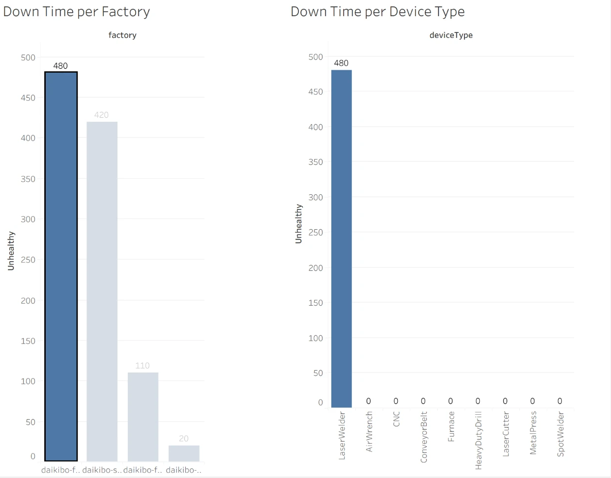

# Deloitte Australia Data Analytics Job Simulation

Forage, October 2026. Tasks: data analysis and forensic technology.

**Certificate:** [`certificate.pdf`](certificate.pdf)

## Task 1: Factory downtime dashboard

Daikibo Industrials runs 36 machines across four factories: Meiyo (Tokyo), Seiko (Osaka), Berlin and Shenzhen. Each machine reports its status every 10 minutes. The client wanted to know where machines were breaking down.



**Approach**

- Converted one month of JSON telemetry to a flat table and loaded it into Tableau.
- Created a calculated field that counts every unhealthy status message as 10 minutes of downtime:
  ```
  Unhealthy = IF [status] = "unhealthy" THEN 10 ELSE 0 END
  ```
- Built two bar charts, downtime per factory and downtime per device type, and joined them in one dashboard. Selecting a factory filters the device chart.
- Checked the Tableau numbers with a short Python script ([`analyze.py`](analyze.py)).

**Result**

| Factory | Downtime (minutes) |
|---|---|
| Seiko (Osaka) | 480 |
| Shenzhen | 420 |
| Meiyo (Tokyo) | 110 |
| Berlin | 20 |

The Seiko plant had the most downtime, and all 480 minutes came from its laser welders. That points the client to one device type at one site instead of a company-wide problem.

**Files:** [`Daikibo_Down_Time.twb`](Daikibo_Down_Time.twb) (Tableau workbook; point the data source at your own copy of `daikibo-telemetry.csv`), [`dashboard.png`](dashboard.png), [`analyze.py`](analyze.py) (expects `daikibo-telemetry-data.json` in the same folder).

## Task 2: Pay equality classification

The client scored pay equality for each factory and job role from −100 to +100, where 0 means fully equal. I sorted each score into a band so the client could see where to investigate first.

| Band | Rule | Count |
|---|---|---|
| Fair | within ±10 | 19 |
| Unfair | 10 to 20 away from 0 | 11 |
| Highly Discriminative | more than 20 away from 0 | 7 |

Five of the seven highly discriminative roles were in management at Meiyo and Seiko (for example Meiyo VP at −26 and Seiko Jr. Manager at −24). Berlin had none.

**File:** [`Equality_Table_classified.xlsx`](Equality_Table_classified.xlsx)

## Skills

Tableau, calculated fields, dashboard design, Excel, Python, JSON data handling.
